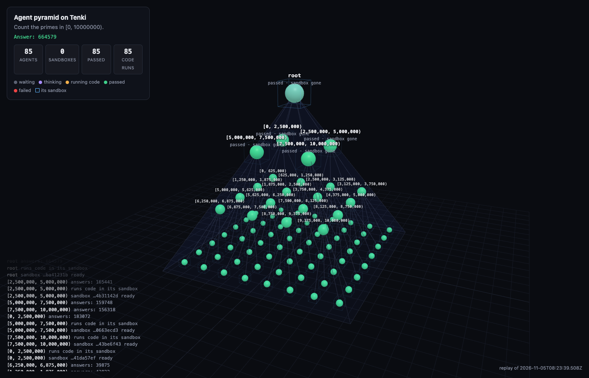

# Agent pyramid

Give a prompt to one agent. It splits the prompt into up to four self-contained prompts and hands each to a sub-agent. Each sub-agent does the same. The bottom agents answer, and every agent combines its sub-agents' answers into an answer to its own prompt. Three levels of splitting by four makes up to 1 + 4 + 16 + 64 = 85 agents. Every agent that runs code gets its own Tenki sandbox, and the sandbox is terminated when the agent finishes. `run.mjs` serves a live 3D view of the pyramid while it works.



## Set it up with a coding agent

Paste this into Claude Code, Codex, Cursor, or another coding agent:

```text
Set up the Tenki "Agent pyramid" example from https://github.com/LuxorLabs/cookbook.
1. Clone the repo and cd into examples/agent-pyramid-tenki.
2. Check that Node.js is 20 or later, then run npm install.
3. The scripts need a Tenki API key (starts with tk_) in TENKI_AUTH_TOKEN. If it isn't set, stop and ask me to export it (keys come from https://app.tenki.cloud). Never print the key or write it to a file.
4. Run node run.mjs --offline, open http://localhost:4321, and confirm the answer is 664579. Then run node verify.mjs.
5. If I have OPENAI_API_KEY or OPENROUTER_API_KEY set, run node run.mjs "<a prompt of mine>" so a model does the splitting.
If a step fails, use the Troubleshooting table in the example's README.md.
```

## Quick start

You need:

- Node.js 20 or later.
- A Tenki API key (`tk_...`) from [app.tenki.cloud](https://app.tenki.cloud), in a workspace that allows about 64 active sessions at once. Set `FANOUT=2` for a workspace with fewer; the pyramid then has at most 15 agents.
- For your own prompts, a model key: `OPENAI_API_KEY` (with `OPENAI_BASE_URL` for any OpenAI-compatible endpoint) or `OPENROUTER_API_KEY`. `MODEL` picks the model; the default is `gpt-4.1-mini`. Without a key, the scripted brain runs.

### 1. Install

```bash
git clone https://github.com/LuxorLabs/cookbook.git
cd cookbook/examples/agent-pyramid-tenki
npm install
```

### 2. Set your API key

```bash
export TENKI_AUTH_TOKEN=tk_...   # TENKI_API_KEY also works, or a key saved with `tenki login`
```

### 3. Run it with no model

```bash
node run.mjs --offline
```

Open http://localhost:4321. The scripted brain makes the moves a model would on one prompt, "Count the primes in [0, 10000000)". Each agent splits its range into four. Each of the 64 bottom agents runs a sieve on its range, in its own sandbox. Every agent above runs the sum of its sub-agents' counts in its own sandbox.

```
3D view: http://localhost:4321
brain: scripted brain (no model)
prompt: Count the primes in [0, 10000000).
up to 85 agents (split by up to 4, 3 levels deep), each with its own sandbox
r.0   183072
r.3   156318
r.2   159748
r.1   165441
r     664579

answer: 664579
85 agents, 85 sandboxes (46 at once), 85 code runs, 20 s
every agent's prompt and answer: out/answer.md
the 3D view stays up at http://localhost:4321; Ctrl-C to quit
```

### 4. Run it with a model and your own prompt

```bash
export OPENROUTER_API_KEY=sk-or-...
node run.mjs "Write a short field guide to the eight planets of the solar system. For each planet give its mass, radius and orbital period, compute its surface gravity in m/s² from mass and radius, and add one memorable fact. End with a table sorted by surface gravity."
```

The model decides at each level whether to split and into how many parts. On this prompt `gpt-4.1-mini` split into inner and outer planets, then one agent per planet, then two to four parts per planet. That made 32 agents. 20 of them ran Python in a sandbox, and the answer took 44 seconds. `out/answer.md` holds every agent's prompt and answer, nested the way the pyramid split them.

### 5. Replay and verify

```bash
node run.mjs --replay    # replay the last run in the viewer; creates no sandboxes
node verify.mjs
```

```
✓ agent-pyramid-tenki: 85 agents, 85 sandboxes, root answer 664579, all terminated (20 s)
```

`verify.mjs` runs the scripted pyramid on Node 20 and needs no model key. It fails unless all of these hold:

- The root answers 664579.
- There are 85 agents, 64 of them at the bottom.
- Every agent booted a sandbox, and every sandbox was terminated.

## The code

`pyramid.mjs` is the whole pattern. Every agent runs the same function, `agent`, which calls itself for each sub-prompt. Simplified:

```js
async function agent(id, title, prompt, level) {
  let sandbox; // booted on the first code run, so an agent that only delegates never takes one
  const subtasks = level < depth ? (await brain.split({ prompt, level, depth, fanout })).slice(0, fanout) : [];
  const children = await Promise.all(subtasks.map((s, i) => agent(`${id}.${i}`, s.title, s.prompt, level + 1)));
  const results = children.map((c) => ({ title: c.title, answer: c.answer }));
  for (;;) {
    const step = await brain.step({ prompt, results, transcript, runsLeft });
    if (step.answer !== undefined) return { id, title, prompt, children, answer: step.answer };
    sandbox ??= await tenki.createAndWait({ cpuCores: 1, memoryMb: 1024, tags: ["agent-pyramid"], metadata: { agent: id } });
    await sandbox.writeFile("/home/tenki/step.py", step.run);
    transcript.push({ run: step.run, output: await sandbox.exec(["python3", "/home/tenki/step.py"]) });
  }
  // finally: await sandbox[Symbol.asyncDispose]()
}
```

The brain answers two questions:

- **`split`** returns up to `fanout` sub-prompts as `{ title, prompt }`, or none to answer directly. Sub-agents see only their own prompt, so the model is told to make each one self-contained.
- **`step`** returns either `{ run: "python code" }` to run in the agent's sandbox, or `{ answer }`. A parent sees its sub-agents' answers in its prompt and is asked to combine them.

`llmBrain` implements both against any OpenAI-compatible chat completions endpoint with plain `fetch`, so there is no model SDK to install. `scripted.mjs` implements them for the prime-counting prompt without a model.

`run.mjs` passes an `emit` callback that receives every state change: thinking, waiting, running, passed, failed, and a sandbox booting, ready or gone. It streams them to `pyramid.html` over server-sent events. The viewer is plain three.js from a CDN. Each level is a square grid twice as wide as the one above, and each agent's sub-agents sit in the quadrant under it. A cube around an agent is its sandbox; it blinks while booting and fades when terminated. Click an agent to see its prompt, its answer, and the last code it ran.

## Things to know

- **Sandboxes come and go with their agents.** An agent boots a sandbox only on its first code run and terminates it when it returns. Children finish before their parent runs its combining code, so the offline run peaked at 46 sandboxes up at once although 85 booted in all, and can never need more than 64 plus the few parents combining at the same moment. With a model, agents that answer from knowledge take no sandbox at all.
- **Depth is the brake.** Models split eagerly. In the planets run, a single planet was split into "physical data", "orbital period" and "memorable fact". `DEPTH` caps the levels at 3 by default and `FANOUT` caps the parts at 4. The bottom level always answers.
- **A failed sub-agent does not sink the pyramid.** Its answer becomes `FAILED: <error>`, and its parent sees that among the results.
- **Each agent's sandbox is 1 vCPU and 1 GiB.** Code runs are capped at two minutes and four runs per agent. Change these in `pyramid.mjs`.
- **Ctrl-C terminates the sandboxes that are still up** before `run.mjs` exits.

## Troubleshooting

| Problem | Fix |
| --- | --- |
| `No Tenki key` | Export `TENKI_AUTH_TOKEN`, or run `tenki login`. |
| `[failed_precondition] workspace balance is empty` | Top up the workspace at [app.tenki.cloud](https://app.tenki.cloud). |
| `[resource_exhausted]` while sandboxes boot | The workspace's active-session limit is below what the pyramid needs. Run with `FANOUT=2`, or `DEPTH=2` for 21 agents. |
| `the scripted brain only answers "Count the primes in [a, b)"` | You gave a prompt without a model key. Set `OPENAI_API_KEY` or `OPENROUTER_API_KEY`, or use `--offline` with no prompt. |
| `model 401` or `model 404` | Check the key, and that `MODEL` names a model your endpoint serves. |
| The 3D view is blank | It loads three.js from cdn.jsdelivr.net. Allow it, or check the browser console. |
| `EADDRINUSE` on 4321 | Set `PORT=4322`. |

## Related

- [Run code in a sandbox](../run-code-in-a-sandbox/): the single-sandbox version of each agent's code run
- [PraisonAI](../praisonai-tenki/): one shared sandbox for a whole agent team, the opposite trade-off
- [OpenAI Agents SDK](../openai-agents-sdk/) and [Claude Agent SDK](../claude-agent-sdk/): give a framework's agents a sandbox tool
